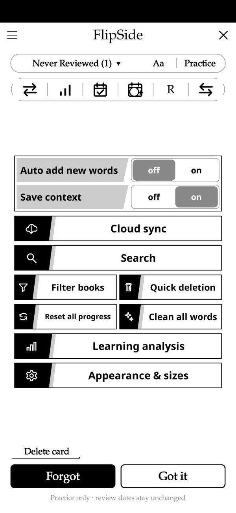
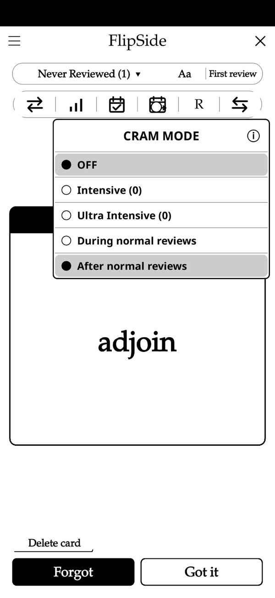
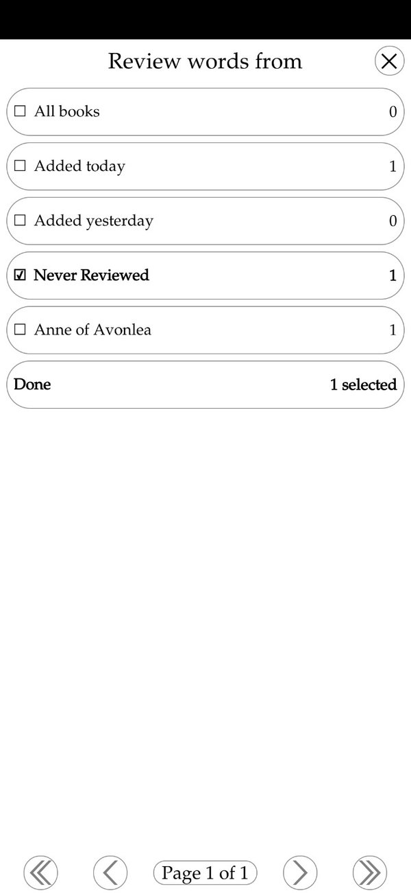
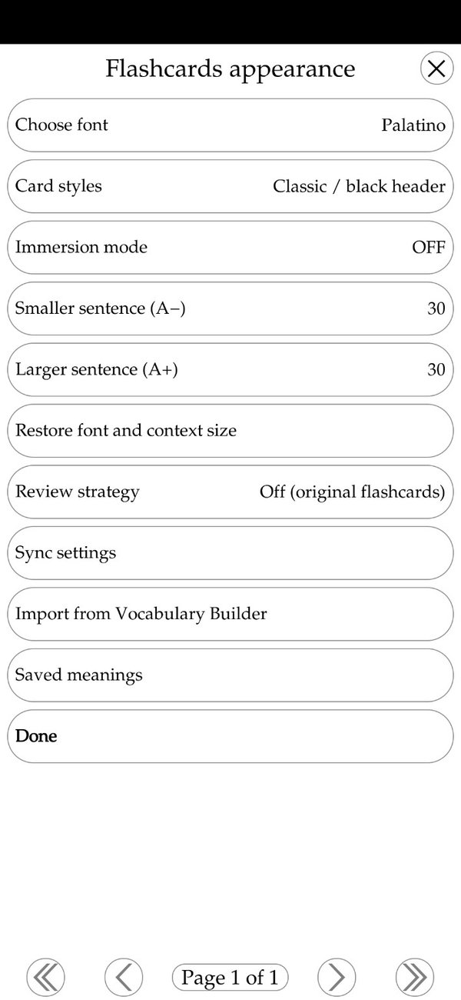
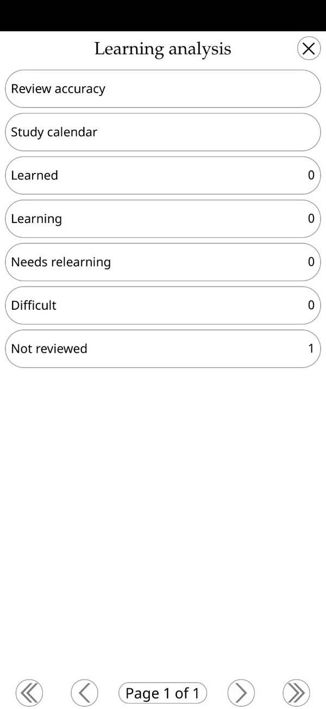
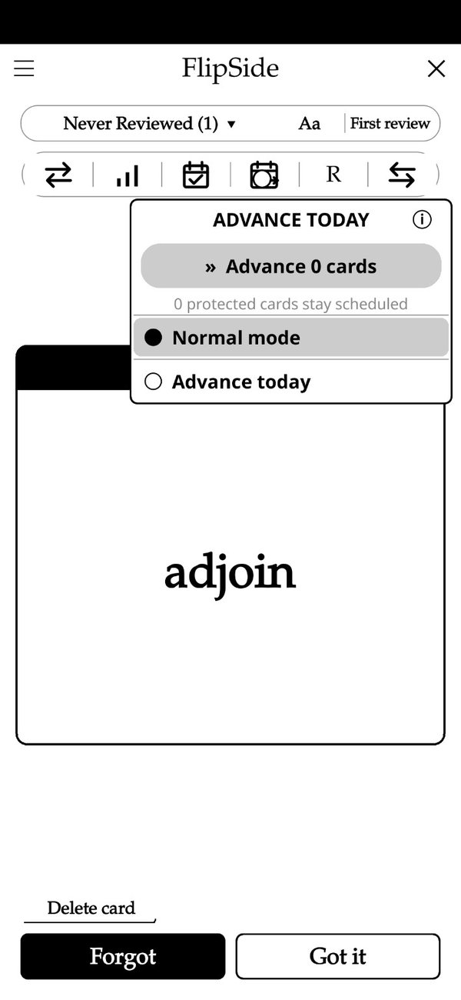
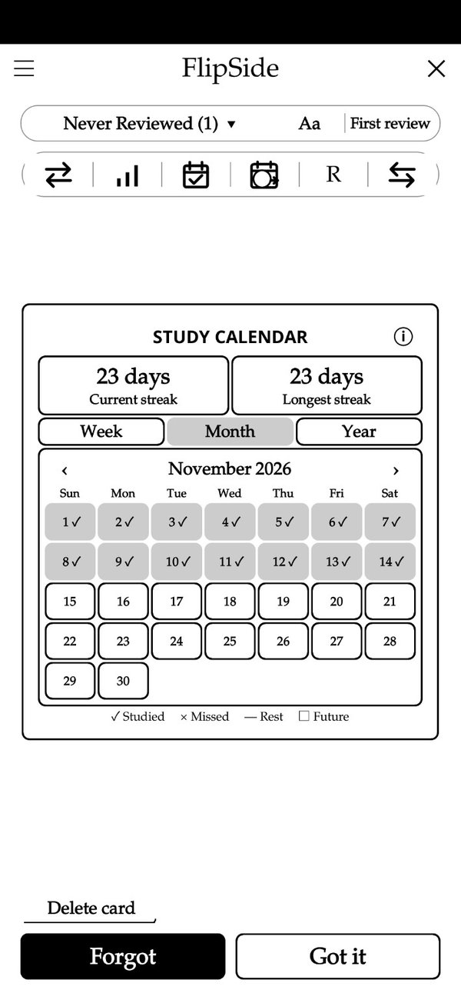
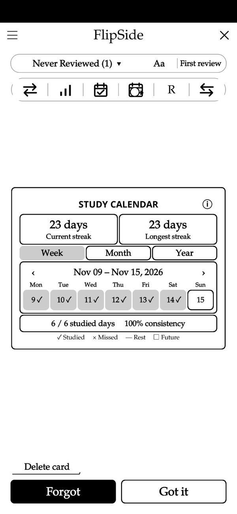

# FlipSide for KOReader

**Vocabulary flashcards designed for e-ink.** Save words while reading, review them in different ways, and continue studying on another device.

<table><tr><td width="50%"> Everything in one menu</td><td width="50%"> Optional Smart Cram</td></tr></table>

## Features at a glance

| Feature | What it does |
| --- | --- |
| **Three card styles** | Recall a meaning, retrieve a missing word from context, or review a sentence. |
| **Smart Cram** | Give extra practice to eligible words. Choose an intensity and when to cram. |
| **Learning Analysis** | View review accuracy, word categories and your study calendar. |
| **Dictionary meanings** | Select and save definitions, even from different dictionaries. |
| **Books & dates** | Choose which books or newly added words to review. |
| **Free practice** | Practise without changing your normal review dates. |
| **Sync** | Transfer supported data through Dropbox or WebDAV. |
| **Appearance** | Pick fonts, card borders and sentence sizes. |

## Install in 3 steps

1. Download the release ZIP. Back up `koreader/settings/flipside/` if updating.
2. Extract **`flipside.koplugin/`** into **`koreader/plugins/`**.
3. Restart KOReader and open **FlipSide** in the search (magnifier) menu. To bring in native Vocabulary Builder words, use **Aa → Import from Vocabulary Builder**.

## Save a dictionary meaning

Open a dictionary from a word, then switch **ON**, select the definition by holding and dragging, and tap **Save**. With **OFF**, the dictionary returns to normal KOReader interactions. Tap outside the dictionary to close it.

Use **Aa → Saved meanings** to manage definitions. The optional **Popup** setting during reading lets you see saved meanings before opening the regular dictionary. **Lock this position** is a separate feature.

**On a card:** tap the word for its dictionary in Meaning Recall; in Contextual Retrieval, first reveal the word, then long-press it. [Full short dictionary guide](docs/DICTIONARY.md).

## Quick tour

<strong>Show more screenshots: filters, styles, calendar and study tools</strong>

<table>
<tr><td> Choose books and dates</td><td> Adjust fonts and card styles</td></tr>
<tr><td> See learning progress</td><td> Optionally advance eligible reviews</td></tr>
<tr><td> Monthly study calendar</td><td> Weekly study calendar</td></tr>
</table>

## Before syncing or resetting

Sync one device at a time, and keep a separate backup: cloud synchronization is **not** a replacement for backup. **Advance Today** may move eligible reviews earlier; **Free practice** does not change due dates. Use **Undo** for a supported recent answer.

**Compatibility:** KOReader; behaviour may depend on device and KOReader version. For bugs, share your device type, KOReader version and *sanitized* logs — never credentials or personal databases.

**License:** [AGPL-3.0](COPYING). Based in part on KOReader's Vocabulary Builder; see [NOTICE](NOTICE.txt) and [upstream KOReader](https://github.com/koreader/koreader).
