# FlipSide screenshot gallery

Screenshots supplied for the FlipSide public documentation. All 20 original screenshots are preserved here with unchanged image pixels and descriptive filenames. Existing screenshots in [`images/`](images/) remain in place.

These images document the `1.0.0-rc.1` user interface; some values and labels are examples from the captured review state.

## Flashcard designs

**Technical corner flashcard** — original `238230.jpg`

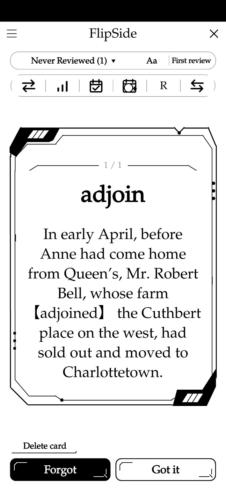

**Black header flashcard** — original `238232.jpg`

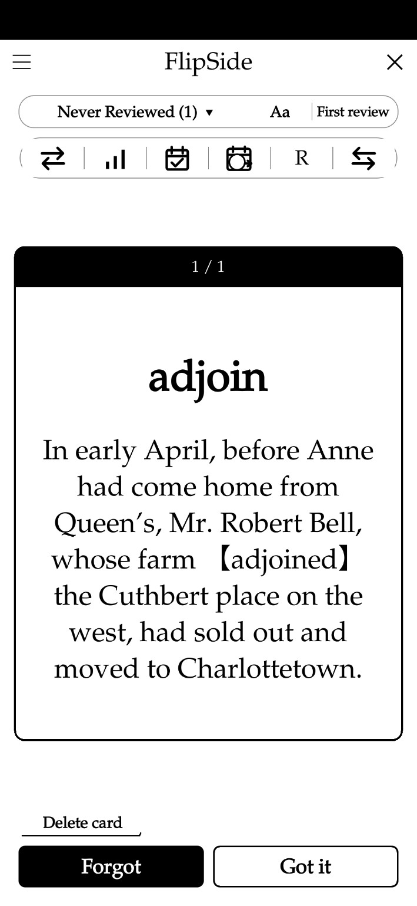

**Angular corner flashcard** — original `238234.jpg`

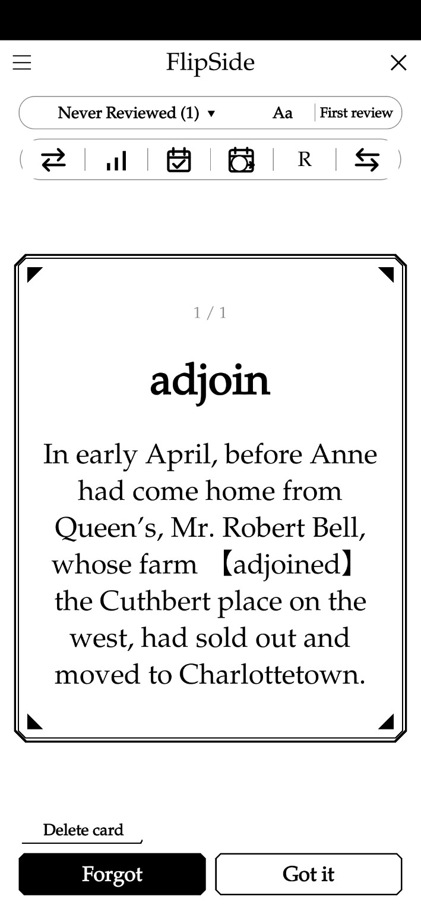

**Borderless minimalist flashcard** — original `238236.jpg`

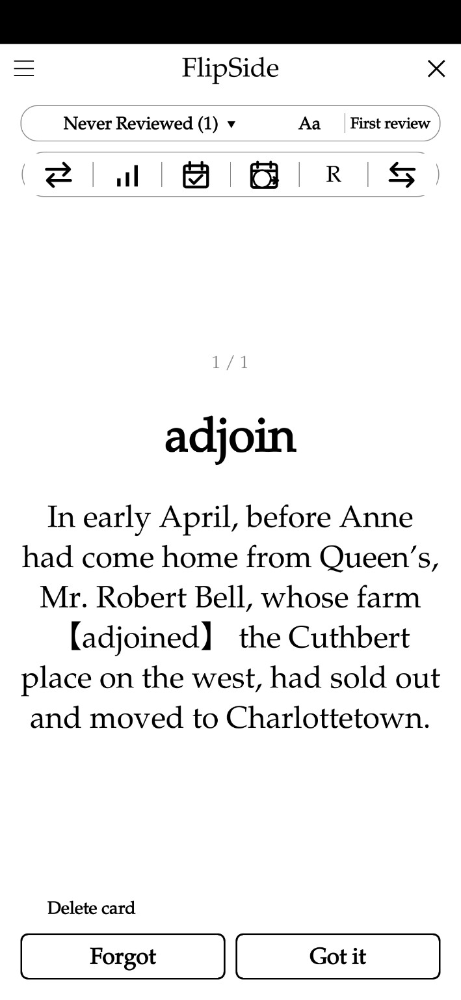

**Sentence card example 1** — original `238242.jpg`

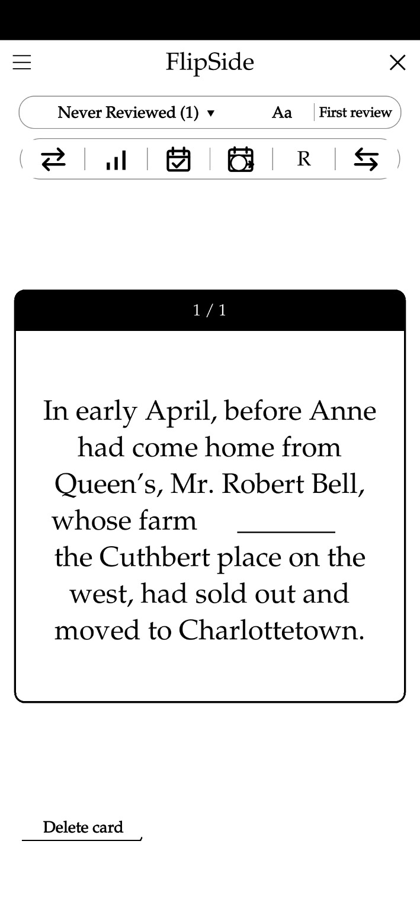

**Sentence card example 2** — original `238244.jpg`

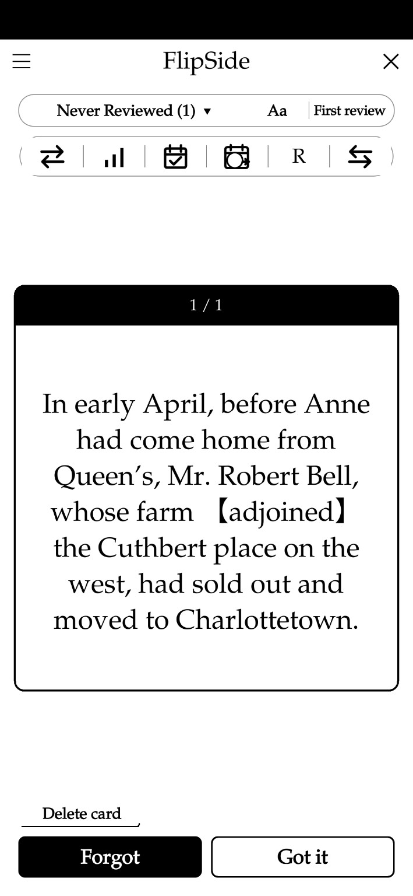

## Dictionary meanings

**Dictionary definition example 1** — original `238238.jpg`

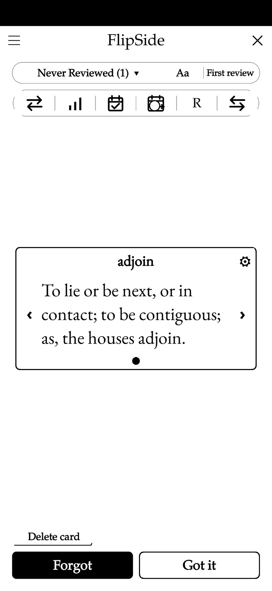

**Dictionary definition example 2** — original `238240.jpg`

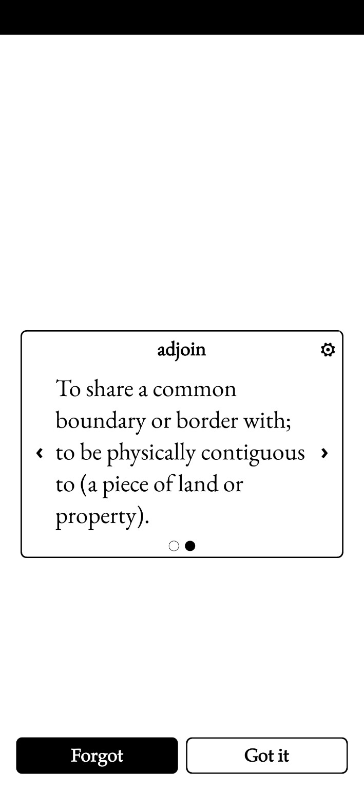

## Study statistics and calendar

**Statistics: today and schedule** — original `238246.jpg`

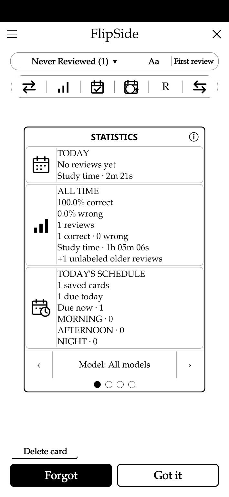

**Statistics: last 7 and 30 days** — original `238248.jpg`

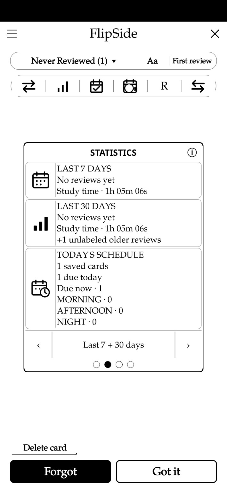

**Study calendar: month** — original `238250.jpg`

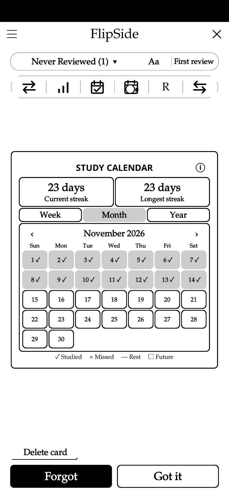

**Study calendar: selected day** — original `238252.jpg`

**Study calendar: week** — original `238254.jpg`

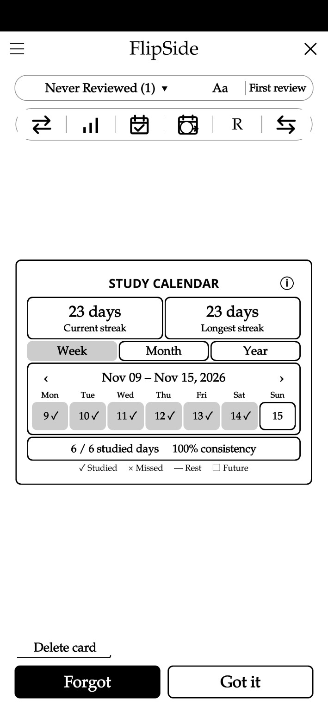

**Study calendar: year** — original `238256.jpg`

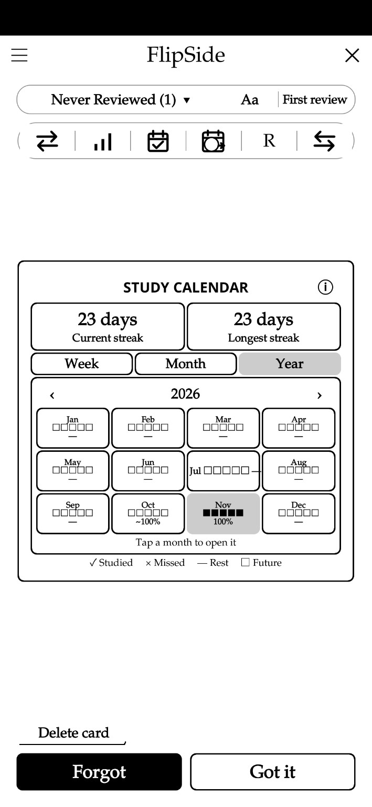

**Learning Analysis categories** — original `238268.jpg`

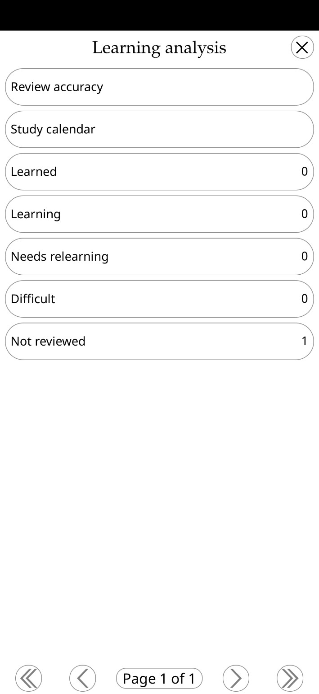

## Menus and study tools

**Advance Today menu** — original `238258.jpg`

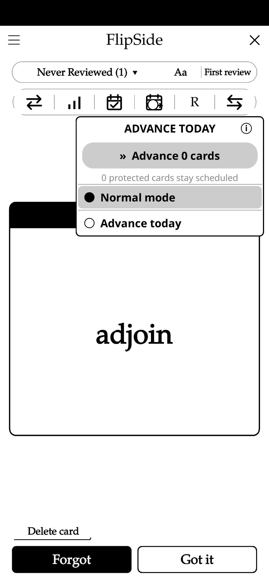

**Cram Mode menu** — original `238260.jpg`

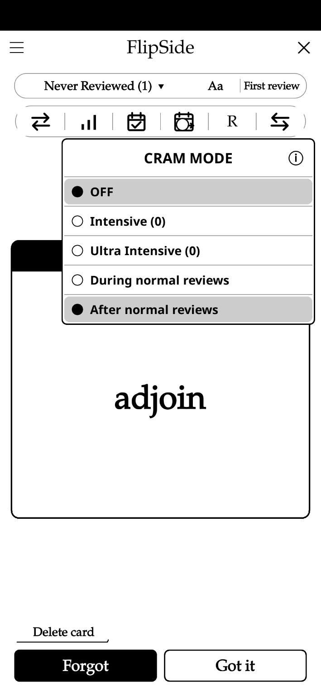

**Appearance and font options** — original `238262.jpg`

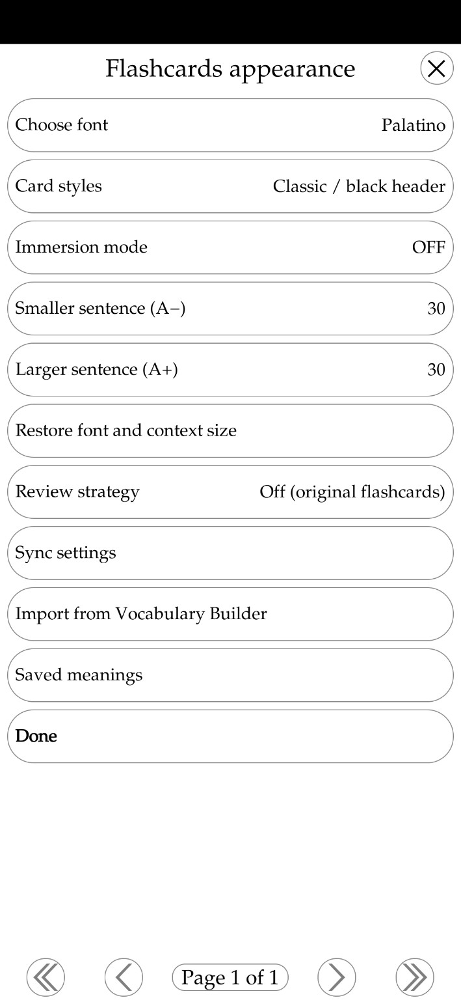

**Review book filters** — original `238264.jpg`

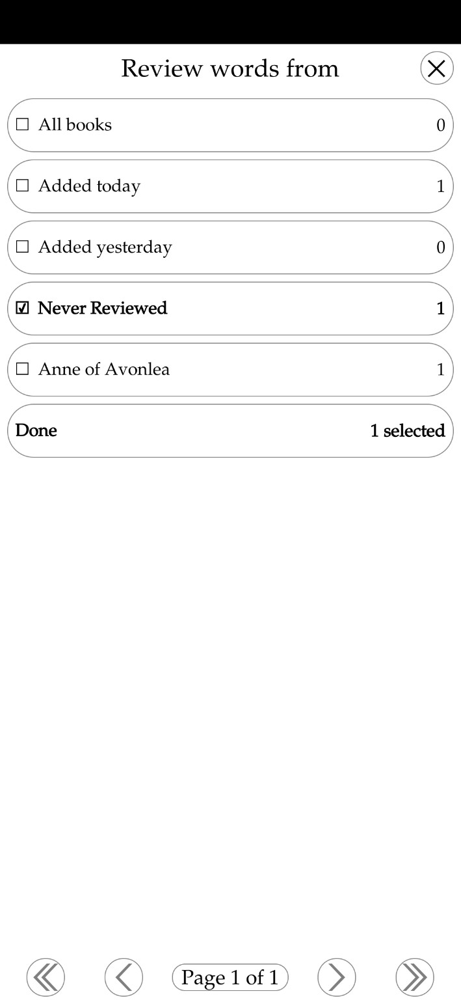

**FlipSide main menu** — original `238266.jpg`

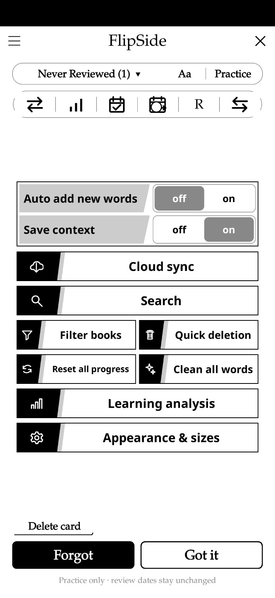

---

See the [project README](../README.md) for features, installation, and the illustrated quick tour. The photos here are documentation assets only; they are not part of the installable plugin.
